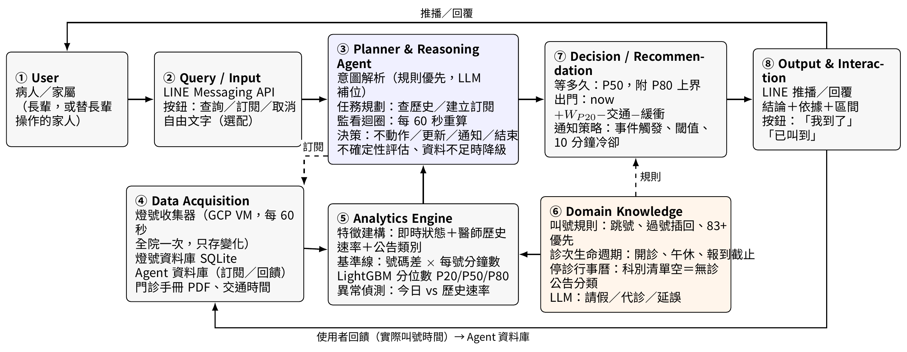
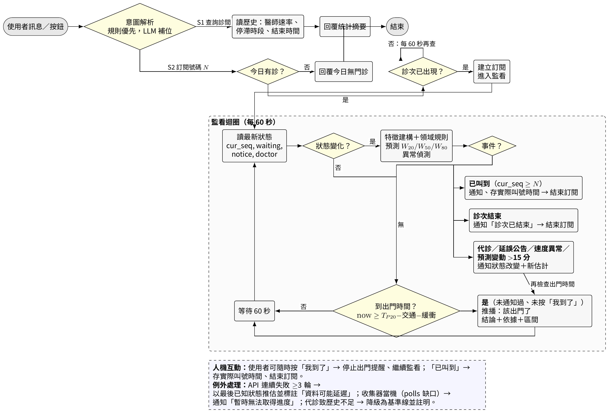

# DESIGN.md — VGHTC Queue Agent

系統設計文件。規範要求自 Proposal 階段建立並持續維護；本版對應 **Proposal 階段（2026-10-29）**，Implementation Mapping 與 Results 於 Final 階段補齊。完整論述與文獻見 `docs/proposal/VGHTC-Queue-Agent-Proposal.pdf`。

章節依規範：Problem → Requirements → Architecture → Components → Data → AI/Analytics → Domain Knowledge → Algorithm → Implementation → How to Run → Results → Limitations。

---

## 1. Problem

給定臺中榮總的診間、午別與掛號號碼 N，在任一時刻回答兩個病人決策：

1. **「我的號碼幾點會被叫到？」**（叫號時間區間）
2. **「我幾點該出門，才能不過號、也不空等？」**（出門建議）

並在狀態改變時（代診、延誤公告、速度異常、預測大幅變動、已叫到、診次結束）重新推理、主動通知。

為什麼不是查表就好：
- 號碼差 ≠ 等待時間。未報到號碼被跳過（單步前進僅 55%）、過號者與 83 歲以上長者從側邊插入、報到截止後不再有新病人。
- 各診間每叫一號 1.0–9.3 分鐘（中位 3.2），差近 10 倍；單一下午全院 89 次 ≥20 分鐘的停滯，最長 86 分鐘。
- 現場已報到人數中位數只占剩餘號碼的 18%：等待取決於後面的人何時出現，不是號碼。
- 一次性估計會失效，需要持續監看的 agent 迴圈。

## 2. Requirements

### 功能
| ID | 需求 |
|---|---|
| S1 | 掛號前查詢：某醫師歷史速率、常停滯時段、通常幾點看完 |
| S2 | 掛號後訂閱：輸入診間、午別、號碼、交通分鐘數；持續監看、預測 P20/P50/P80、到達出門時間推播一次；可在開診前訂閱（診次出現後才開始預測） |
| S3 | 變化提醒：事件觸發重新推理並通知，同類通知 10 分鐘冷卻 |
| UI | LINE Messaging API；Rich Menu 按鈕：查詢／訂閱／取消／「我到了」／「已叫到」；自由文字為選配 |

### 非功能
- 對醫院 API **零額外請求**：Agent 讀收集器的資料庫，不自行輪詢。
- 不蒐集個資：不要求身分證、病歷號、定位；不使用「以身分證／病歷號查詢掛號」API；訂閱結束後刪除 LINE 使用者 ID。
- 資料不足時可降級：模型未訓練、代診致歷史不足時退回排隊式基準線並告知信心下降。
- LLM 不在關鍵路徑：只做公告分類（失敗退回關鍵字）與解釋生成；通知與否由確定性規則決定。
- 單機可跑：CPU 可訓練的表格模型；GCP 免費層即可。

### 範圍外
不掛號、不取消、不換診、不查個人掛號資料；系統無法得知使用者是否已報到，所有提醒皆為建議。

## 3. Architecture



八個模組（編號對應規範的 ①–⑧）：

| # | 模組 | 職責 |
|---|---|---|
| ① | User | 病人／家屬（長輩，或替長輩操作的家人） |
| ② | Query / Input | LINE Messaging API；按鈕為主，自由文字選配 |
| ③ | Planner & Reasoning Agent | **系統核心**：意圖解析（規則優先、LLM 補位）、任務規劃（查歷史／建立訂閱）、每 60 秒的監看—推理—決策迴圈（不動作／更新／通知／結束）、不確定性評估與降級 |
| ④ | Data Acquisition | 燈號收集器（已上線）→ 燈號資料庫 SQLite；Agent 資料庫（訂閱／回饋，獨立）；門診手冊 PDF、使用者自填交通時間 |
| ⑤ | Analytics Engine | 特徵建構、排隊式基準線、LightGBM 分位數回歸 P20/P50/P80、異常偵測（今日 vs 歷史速率） |
| ⑥ | Domain Knowledge | 叫號規則、診次生命週期、停診行事曆、公告語意分類 |
| ⑦ | Decision / Recommendation | 「等多久」= P50 附 P80；「幾點出門」= now + W_P20 − 交通 − 緩衝；通知策略（事件觸發、閾值、冷卻） |
| ⑧ | Output & Interaction | 推播三段：結論、依據、區間；「我到了」「已叫到」按鈕；使用者回報作為真值 |

資料／控制流：① → ② → ③ → ⑦ → ⑧ → ①；④ 與 ⑥ 餵入 ⑤，⑤ 回 ③；⑥ 同時約束 ⑦；⑧ 的使用者回饋寫回 ④ 的 Agent 資料庫。

## 4. Components

### 4.1 燈號收集器（`collector/`，已實作）
- `vghtc_collector.py`：純標準函式庫。每 60 秒以 `OPDSection=""` 一次取得全院門診燈號，只在數值變化時寫入 SQLite；`seen_since` 記錄上一次確認時間，變化精確落在 `(seen_since, ts]`。子命令 `once` / `run` / `stats` / `export`，`--selftest`。
- `deploy/`：GCP 專案建置、VM 安裝（systemd 自動重啟）、部署、每日備份至 GCS、`status.py` 每 5 分鐘寫 `status.json`。
- `dashboard/app.py`：Cloud Run 監控網頁，讀 GCS bucket 而非連 VM（VM 死掉頁面仍可開並變紅），IAP 保護。

### 4.2 Agent（`agent/`，Final 階段）
- `monitor.py`：Algorithm 1 的監看迴圈，每個訂閱一個狀態機。
- `events.py`：事件偵測與冷卻。
- `linebot/`：Webhook、Rich Menu、推播模板（結論／依據／區間）。
- `explain.py`：LLM 解釋生成（可快取）。

### 4.3 模型（`model/`，Final 階段）
- `features.py`：Algorithm 2 的特徵建構。
- `baseline.py`：號碼差 × 每號分鐘數，依序退回醫師歷史 → 同科 → 全院中位數。
- `train.py`：LightGBM 分位數回歸（α = 0.2 / 0.5 / 0.8），時間序列切分。
- `backtest.py`：評估指標（見 §11）。

### 4.4 領域知識（`agent/domain.py`，Final 階段）
規則表、診次生命週期常數、停診判斷、公告分類 few-shot 提示與關鍵字退路。

## 5. Data

### 5.1 來源
| 來源 | 內容 | 取得方式 |
|---|---|---|
| 臺中榮總看診進度 API（公開，無需登入） | 目前號、最末號、已報到待看診人數、過號看診號、過號等待人數、午別、診間、醫師、公告 | 收集器每 60 秒一次全院查詢 |
| 門診手冊 PDF | 醫師排班 | 每月 2 號抓至 GCS `schedules/` |
| 網路預約掛號說明 | 開診 08:30/13:30/18:00、初診報到截止 11:30/16:30/19:30 | 靜態常數 |
| 使用者 | 診間、午別、號碼、交通分鐘數；「我到了」「已叫到」 | LINE |

### 5.2 欄位的真正意義（2026-10-22 驗證，詳見 `collector/README.md`）
- `CUR_WAITING_CNT`（已報到待看診人次）是**現場人數**，不是 N 前方人數；中位數只占剩餘號碼的 18%（p90 50%），3.7% 的時刻超過剩餘號碼。
- `DELAY_WAITING_CNT` 在觀測中恆等於 `CUR_WAITING_CNT`。
- `CURSEQ − TOTSEQ = 5` 代表已追上最末號（醫院顯示慣例）。
- 下午診 12:20–13:36 出現在 API，叫號中位 13:31 開始；診次看完約 9 分鐘後消失；科別清單為空即今日無診。

### 5.3 資料庫（SQLite，收集器）
| 表 | 內容 |
|---|---|
| `sections` | 科別代碼與名稱 |
| `sessions` | 診次 = 日期 + 午別 + 診間 + 科別；含醫師、最新公告 |
| `observations` | 燈號有變化時一筆：ts、seen_since、cur_seq、tot_seq、waiting、passed、doctor |
| `notice_changes` | 公告文字變化（請假、延誤等） |
| `polls` | 每輪請求成功／失敗、變化筆數；可稽核輪詢負擔 |

Agent 資料庫（獨立）：`subscriptions`（LINE user id、診間、午別、N、交通分鐘、狀態）、`feedback`（去識別化：診次、N、預測、實際叫號時間、按鈕事件）。

### 5.4 真值定義
號碼 N 的叫號時間 = 該診次第一筆 `cur_seq ≥ N` 的觀測，實際落在其 `(seen_since, ts]`，誤差 ≤ 60 秒。

### 5.5 現況
2026-10-22 上線；2 個門診日 259 診次、9,924 筆變化；每日約新增 4–6 千筆。10/23 為颱風日、10/24–26 光復節連假停診，分析時標記。

## 6. AI / Analytics

### 6.1 特徵（Algorithm 2）
`gap`（號碼差）、`onsite`（現場人數）、`passed`（過號人數）、`r_today`（30 分鐘滾動每號分鐘數）、`r_hist`（該醫師在同星期／午別／時段的歷史速率，退路：同科 → 全院）、`r_today / r_hist`（漂移）、`elapsed`（診次已進行時間）、`toBreak`（距報到截止／午休）、`caughtUp`、`nClass`（公告類別）、`doctorChanged`、`weekday`、`timeFlag`、`hour`。

### 6.2 模型
- **基準線**（永遠可用，也是退路）：W50 = gap × r；W20 = 0.7 W50；W80 = 1.5 W50。
- **主模型**：LightGBM 分位數回歸，三個分位數各一個模型（α = 0.2 / 0.5 / 0.8）；時間序列切分（前期訓練、後期測試）；P80 覆蓋率需校準並報告。
- **異常偵測**：drift = r_today / r_hist，|drift − 1| > 0.5 視為速度異常。
- **不確定性與決策分離**：「等多久」回報 P50 附 P80 上界（低估比高估傷人）；「幾點出門」用 P20（晚了會過號，方向相反）。

### 6.3 LLM 的角色（刻意受限）
- 公告分類：few-shot 分為 請假／代診／延誤／截止／其他；失敗退回關鍵字比對。
- 解釋生成：把 (事件, W20/W50/W80, 狀態) 轉成三段推播文字；可快取。
- 意圖補位：按鈕無法涵蓋的自由文字。
- **不**決定要不要通知、**不**產生預測數字。

### 6.4 為何不用序列深度模型
Shin 2024、Guo 2025 顯示樹模型在門診等待時間上穩定優於線性與深度模型（含 TabNet、FT-Transformer）；資料量級為萬筆、CPU 可訓練、可解釋（SHAP）。回測若 ML 贏不了基準線就用基準線（Chocron 2022）。

## 7. Domain Knowledge

| 類別 | 內容 | 來源 | 設計上的用途 |
|---|---|---|---|
| 叫號規則 | 報到後才叫號；未報到跳過；過號者重新報到插回；83 歲以上插卡自動排序（北榮明文「2 正常號 + 1 位 85 歲以上 + 1 位過號者」） | 中榮診間公告、北榮便民手冊 | 解釋跳號與倒退；不建模年齡，由醫師速率分佈隱性學習 |
| 診次生命週期 | 開診 08:30/13:30/18:00；初診報到截止 11:30/16:30/19:30；最後報到 平日 20:00、週六 11:30；下午診 12:20 起出現、13:30 才叫號；看完約 9 分鐘後消失 | 中榮掛號說明、本專題觀測 | 提前訂閱時等待；`toBreak` 特徵；診次結束判斷 |
| 停診行事曆 | 科別清單為空即今日無診（2026 光復節連假實測）；颱風日 | API 行為 | 訂閱前檢查，回「今日無門診」 |
| 公告語意 | 請假／代診／延誤／報到截止 | 公告文字 | 事件觸發、特徵 `nClass` |
| 等候心理 | 告知區間、寧可略高估；誤差 >20 分鐘失去意義（Zhang 2023） | 文獻 | 推播格式與閾值 15 分鐘 |

## 8. Algorithm

### Algorithm 1 — Queue Agent: Subscription Monitoring Loop
```
Input : subscription s = (room, timeFlag, N, travelMin), call-light store DB
Output: notifications; ground-truth record when N is called

01: if DB.sectionListEmpty(today): notify("今日無門診"); return
02: sess ← DB.findSession(today, s.room, s.timeFlag)
03: while sess = ∅: sleep(60 s); re-query sess            ▷ 提前訂閱
04: arrived ← false; notifiedLeave ← false; lastEst ← ∅
05: while sess.active:
06:     st ← DB.latestState(sess)                          ▷ cur_seq, waiting, passed, doctor, notice
07:     if st.cur_seq ≥ N: notify("已叫到 N 號"); record(sess, N, st.ts); break
08:     x ← BuildFeatures(sess, st, N)                      ▷ Algorithm 2
09:     (W20, W50, W80) ← Predict(x)
10:     drift ← rateToday(sess) / hist.rate(sess.doctor)
11:     E ← DetectEvents(st, lastState, drift, W50, lastEst)
        E ⊆ { doctorChanged, notice ∈ {請假, 代診, 延誤}, |drift − 1| > 0.5, |W50 − lastEst| > 15 }
12:     if E ≠ ∅ and cooldownOK(E): notify(Explain(E, W20, W50, W80, st))
13:     arrived ← arrived ∨ user.pressed("我到了")
14:     leaveAt ← now + W20 − s.travelMin − BUFFER
15:     if ¬arrived ∧ ¬notifiedLeave ∧ now ≥ leaveAt:
16:         notify(Explain("該出門了", W20, W50, W80, st)); notifiedLeave ← true
17:     lastEst ← W50; lastState ← st; sleep(60 s); refresh sess
18: if sess.ended ∧ st.cur_seq < N: notify("診次已結束，請洽診間")
```

### Algorithm 2 — Wait-Time Estimation with Domain Features
```
Input : session sess, state st, target N, history H
Output: (W20, W50, W80) in minutes

01: gap ← N − st.cur_seq                                   ▷ 號碼差
02: onsite ← st.waiting                                    ▷ 現場人數，非 N 前方人數
03: r_today ← rollingRate(sess, 30 min)                    ▷ 今日每號分鐘
04: r_hist ← H.rate(doctor, weekday, timeFlag, hour)
05: if r_hist = ∅: r_hist ← H.rate(section); flag ← fallback
06: elapsed ← now − sess.start; toBreak ← nextBreak(timeFlag) − now
07: caughtUp ← [st.cur_seq − st.tot_seq = 5]              ▷ 已追上最末號
08: nClass ← ClassifyNotice(st.notice)                     ▷ LLM few-shot，失敗退回關鍵字
09: x ← (gap, onsite, st.passed, r_today, r_hist, r_today/r_hist,
         elapsed, toBreak, caughtUp, nClass, doctorChanged, weekday, timeFlag, hour)
10: if model.trained ∧ flag ≠ fallback:
11:     (W20, W50, W80) ← LightGBM_quantile(x)
12: else:
13:     r ← r_today if available else r_hist
14:     W50 ← gap · r; W20 ← 0.7 W50; W80 ← 1.5 W50       ▷ baseline
15: return (W20, W50, W80)
```

常數（初值，回測後調整）：BUFFER = 5 分鐘；預測變動閾值 15 分鐘；漂移閾值 0.5；冷卻 10 分鐘。

### 流程圖


## 9. Implementation（Implementation Mapping）

| 設計元件 | 程式位置 | 狀態 |
|---|---|---|
| ④ 燈號收集器 | `collector/vghtc_collector.py` | 已上線（2026-10-22） |
| ④ 部署／備份／監控 | `collector/deploy/`, `collector/dashboard/` | 已上線 |
| ④ Agent 資料庫 | `agent/db.py` | Final |
| ③ 監看迴圈（Alg. 1） | `agent/monitor.py` | Final |
| ③ 事件偵測與冷卻 | `agent/events.py` | Final |
| ⑤ 特徵（Alg. 2）／基準線／模型 | `model/features.py`, `model/baseline.py`, `model/train.py` | Final |
| ⑤ 回測 | `model/backtest.py` | Final |
| ⑥ 領域知識 | `agent/domain.py` | Final |
| ⑦ 決策與通知策略 | `agent/monitor.py`（決策段） | Final |
| ⑧ LINE 介面 | `agent/linebot/` | Final |
| LLM 分類／解釋 | `agent/explain.py` | Final |

技術選型：Python 3.11、SQLite、LightGBM、LINE Messaging API（免費方案每月推播 200 則，demo 足夠）、LLM API（公告分類與解釋，短呼叫可快取）、GCP e2-micro（收集器與 Agent 同機）。

## 10. How to Run

目前可執行的只有收集器：

```bash
cd collector
python vghtc_collector.py once     # 跑一輪確認連得上
python vghtc_collector.py run      # 持續收集
python vghtc_collector.py stats    # 資料庫概況
```

正式環境（GCP）部署步驟與指令見 `collector/README.md`。Agent 與模型的執行方式於 Final 階段補上。

## 11. Results

**Proposal 階段尚未完成實驗，本節為評估計畫。**

- 資料：收集器累積的真實燈號資料，時間序列切分（前期訓練、後期測試）。
- 基準線：B0 固定每號 3.2 分鐘；B1 號碼差 × 醫師歷史平均；B2 滾動平均。
- 模型指標：MAE、分位數損失（pinball loss）、P80 覆蓋率、低估比例。
- 病人端指標：過號率（依建議出門仍晚於實際叫號的比例）、平均空等分鐘、每次訂閱通知次數。
- 使用者測試：Final 階段以組員及親友進行兩週 LINE Bot 實測。
- 預期結果：(1) 臺中榮總門診叫號時間資料集與統計特性；(2) 在過號率與空等分鐘上優於固定規則的分位數模型，並量化醫師效應與停滯的誤差貢獻；(3) 可實際使用的 LINE 候診代理人。

## 12. Limitations（已知）

- 只能外部觀測燈號，看不到年齡、報到時間、未到名單；插隊效果只能隱性學習。
- `CUR_WAITING_CNT` 是現場人數而非 N 前方人數。
- 系統無法得知使用者是否已報到，所有提醒皆為建議。
- 單一醫院；跨院移植須重訓。
- 預測一旦公布會改變病人行為（開放系統），需監測漂移並收集回報。
- 風險：醫院 API 改版（有失敗記錄與告警）；GCP 試用 2026-12-20 到期前須啟用完整帳戶。

---

## 變更紀錄

| 日期 | 內容 |
|---|---|
| 2026-10-29 | Proposal 階段初版：自 Proposal 文件整理 §1–§8、§11 評估計畫；§9、§10 標示 Final 待補 |
