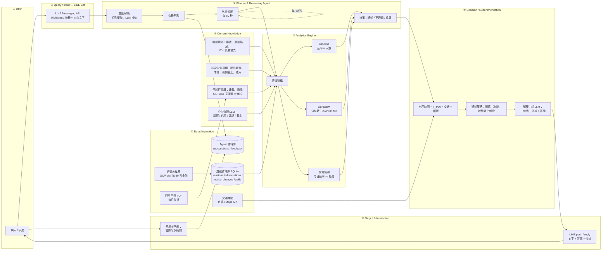
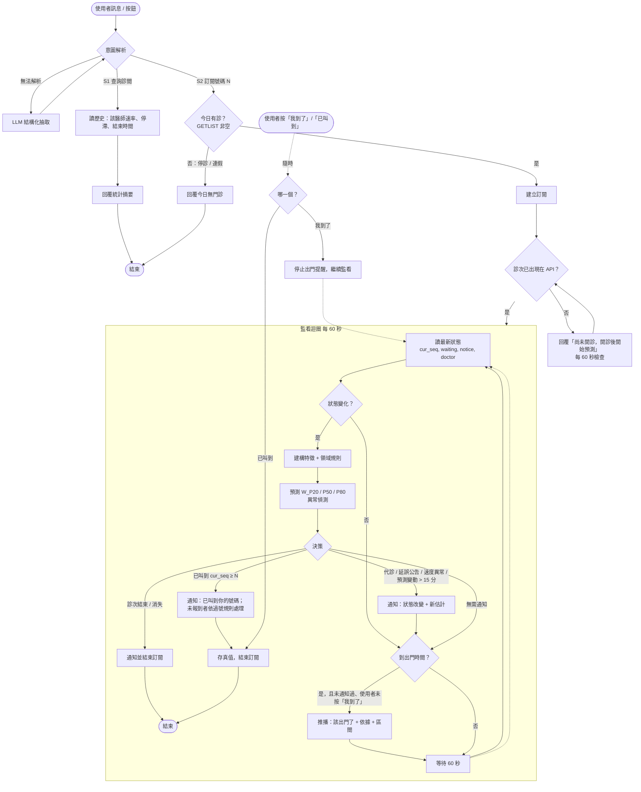

# Proposal 草稿 v0.2 — Abstract + Proposed Scheme

> 專題：**VGHTC Queue Agent — 臺中榮總門診候診智慧代理人**
> 課程：人工智慧與資訊安全 ｜ 組員 4 人 ｜ 繳交 2026-11-02
> 這份是討論用草稿。定稿會轉成 IEEE 雙欄 LaTeX；圖目前用 Mermaid 文字描述，定稿時重畫成正式圖。
> 標 `[TODO-ref]` 的地方是需要在 Related Work 階段補上 2025–2026 文獻／統計的位置，**不要留空交出去**。

---

## 0. 要先跟你確認的設計決定

| # | 決定 | 我的建議 | 為什麼 |
|---|---|---|---|
| D1 | 系統正式名稱 | 中文「臺中榮總門診候診智慧代理人」，英文 **VGHTC Queue Agent** | 跟 repo 名一致 |
| D2 | 「該出門」用哪個分位數 | 用**偏早**的估計（P20 的叫號時間）決定出門；回答「還要等多久」時給 P50 和 P80 | 過號的代價遠大於多等幾分鐘，兩個問題的風險方向相反，要分開處理（見 §4.6） |
| D3 | Agent 即時資料從哪來 | 直接讀收集器的 SQLite，**不另外打醫院 API** | 收集器已經每分鐘抓全院，Agent 零額外負擔；回應醫院負擔的倫理問題 |
| D4 | LLM 用在哪 | 只用三處：公告分類、自然語言提問的意圖解析、把預測寫成一句人話 | 每一處都有明確理由，避免被問「為什麼要塞 LLM」 |
| D5 | 交通時間 | Proposal 寫成「使用者自填分鐘數，選配 Google Maps Distance Matrix」 | 自填零成本、沒有定位隱私問題；Maps 當 Final 的加分項 |
| D6 | 評估的「真值」 | 號碼 N 的叫號時間 = 該診次第一筆 `cur_seq ≥ N` 的觀測時間 | README 已定義，誤差 ≤ 60 秒 |

---

## 1. Abstract（A–F 六段）

**A. Attention Getter.** 臺灣於 2025 年進入超高齡社會（65 歲以上人口超過 20%）`[TODO-ref: 國發會 2025]`，而高齡者正是大型醫院門診的主要使用者。臺灣民眾年均門診次數長期位居 OECD 前段 `[TODO-ref: 健保署/OECD 2025]`，大型醫學中心單一診次掛號動輒上百號，病人普遍提早到院後長時間空等。本專題於 2026 年 10 月對臺中榮民總醫院全院門診燈號的連續觀測顯示：單一下午 5 小時內全院共出現 89 次兩次叫號間隔超過 20 分鐘的停滯，各診間每叫一號所需時間的中位數為 3.2 分鐘但差距近 10 倍（p10 為 1.9、最快診間 1.0 分鐘、最慢 9.3 分鐘），而「已報到待看診人數」的中位數僅為剩餘號碼數的 18%——亦即大多數病人尚未到院，等待時間取決於「後面的人何時出現」，而非「現在排了幾個人」。

**B. But.** 各醫院網站與 App 雖提供即時燈號，卻只回答「現在看到幾號」，而非病人真正想知道的「我幾點會被叫到、幾點該出門」。少數提供「到診前 N 號提醒」的官方 App（如臺北榮總的前 5 號提醒；臺中榮總官方 App 的功能 `[TODO: 查證臺中榮總 App 是否有叫號提醒，這決定 Research Gap 怎麼寫]`）採固定號碼差規則，忽略了醫師速度差異、跳號（未報到號碼被略過，本專題觀測中每次叫號只前進 1 號的比例僅 55%）、過號插回與長者優先等現場機制。學術上，門診候診時間預測研究多以醫院內部掛號／報到系統資料為基礎 `[Ang 2016; Pak 2021; JMIR 2025]`，依賴病人無法取得的內部資料，且文獻指出模型在醫院之間不可移植，須學習醫師與診間的個別效應；至今未見以**公開燈號資料**從病人端建立預測與主動提醒的研究。

**C. Cure.** 為解決上述問題，本專題提出 **VGHTC Queue Agent**：一個以臺中榮總公開看診進度資料為基礎的門診候診 Domain AI Agent。使用者只需透過 LINE 提供診間、午別與自己的號碼，Agent 即持續監看該診的即時狀態，預測其號碼的叫號時間區間，結合使用者交通時間給出「該出門」的主動提醒，並在代診、延誤、速度異常等狀態改變時重新推理並通知。

**D. Development.** 系統由八個模組組成：自 2026-10-22 起於 GCP 全天候運行的燈號收集器每分鐘取樣臺中榮總全院門診診間並僅儲存變化（累積 2 個門診日即達 259 個診次、9,924 筆變化）；分析引擎以每位醫師的歷史與當日即時速率為特徵，使用梯度提升樹（LightGBM）進行分位數回歸（P20/P50/P80）；領域知識層編碼臺中榮總門診的叫號規則（跳號、過號插回、83 歲以上長者優先排序）、診次生命週期（開診延遲、午休、報到截止）與停診行事曆，並以 LLM 將診間公告分類為「請假／代診／延誤／報到截止」等特徵；推理代理人以監看迴圈整合預測、不確定性與非對稱風險（過號代價高於空等），決定何時通知、通知什麼，並以自然語言附上依據。

**E. Experiments.** 評估以收集器累積的真實燈號資料進行時間序列回測（以前期資料訓練、後期資料測試，避免洩漏）：對每個診次、每個觀測時點與剩餘號碼，比較三個基準線——固定每號分鐘數、號碼差乘以該醫師歷史平均、文獻常用的滾動平均——與本專題模型。指標包括 MAE、分位數損失（pinball loss）、P80 覆蓋率，以及三個面向使用者的指標：「過號率」（依建議出門時間到院仍晚於實際叫號的比例）、「平均空等分鐘」（到院至叫號的時間）與「每次訂閱的通知次數」（騷擾程度）。Final 階段並以組員及親友進行為期兩週的 LINE Bot 實際使用測試。

**F. Expected Outcomes.** 預期本專題將產出：(1) 以公開燈號資料建立的臺中榮總門診叫號時間資料集與其統計特性分析（跳號、停滯、醫師效應）；(2) 一個在過號率與空等時間上同時優於固定規則基準線的分位數預測模型，並量化醫師效應、跳號與停滯對預測誤差的貢獻；(3) 一個可實際使用的 LINE 候診代理人，展示「監看—預測—推理—主動提醒」的 Domain AI Agent 設計；(4) 一套只使用公開資料、不觸及任何個資的資料倫理實作範例。

---

## 2. Proposed Scheme / Proposed Design

### 2.1 應用情境（① User / Application Scenario）

對象是臺中榮總的門診病人與陪同家屬，三個使用情境：

| 情境 | 使用者輸入 | Agent 回應 |
|---|---|---|
| S1 掛號前查詢 | 「皮膚科 2526 診平常等多久？」 | 該醫師的歷史每號分鐘數、常見停滯時段、通常幾點看完，供使用者決定要不要掛 |
| S2 掛號後訂閱 | 診間 2526、下午診、號碼 85、交通 25 分鐘 | 持續監看；回覆目前狀態、預測叫號時間區間、建議出門時間；時間到主動推播。可在開診前（甚至前一天）訂閱，Agent 等診次出現後才開始預測 |
| S3 變化提醒 | 無（被動） | 偵測代診、公告出現請假／延誤、今日速度明顯異於歷史、預測大幅改變、已過號、診次結束，重新推理並通知 |

不做的事：不掛號、不取消、不換診、不查詢個人掛號資料（不收身分證／病歷號）。**系統無法得知使用者是否已報到**（那需要個資），所以所有提醒都是「建議」，是否出門由使用者決定；使用者可按「我到了」停止出門提醒、按「已叫到」結束訂閱。

### 2.2 系統架構（System Architecture）



各模組說明（定稿時每個模組一段，這裡先寫重點）：

**① User / Application Scenario** — 臺中榮總門診病人與家屬。設計前提：使用者可能是長輩或替長輩操作的家人，所以介面以按鈕為主、自由文字為輔。

**② Query / Input（LINE Bot）** — 採用 LINE Messaging API（LINE Notify 已於 2025 年停用）。Rich Menu 提供「查詢診間」「訂閱我的號碼」「取消」三個入口；訂閱只需四個欄位：診間號、午別、號碼、交通分鐘數。自由文字（例如「我 85 號大概幾點」）交給 ③ 的意圖解析。**刻意不要求**身分證、病歷號或定位。

**③ Planner & Reasoning Agent** — 系統核心，是一個**監看—推理—決策迴圈**而不是問答機器人：
- *意圖解析*：規則優先（按鈕、正規表達式抓診間／號碼），無法解析時才呼叫 LLM 做結構化抽取。
- *任務規劃*：依意圖決定要查歷史（S1）還是建立訂閱並進入監看（S2）。
- *監看迴圈*：每 60 秒讀取該診次最新狀態（與收集器同步），重新建構特徵、重新預測。
- *決策*：綜合預測區間、異常偵測、領域規則與通知策略，決定「不動作／更新內部估計／通知使用者／結束訂閱」。
- *不確定性與限制評估*：預測以區間呈現；當資料不足（新醫師、代診）時降級為基準線並在回覆中註明。

**④ Data Acquisition / Retrieval** — 唯一的即時資料來源是本專題自建的燈號收集器（已於 2026-10-22 上線）：每 60 秒呼叫一次醫院公開 API 取得全院診間狀態，只儲存變化到 SQLite（`sessions`、`observations`、`notice_changes`、`polls` 四張表）。Agent 與收集器部署在同一台 VM，直接讀此資料庫，**不對醫院 API 產生額外請求**；Agent 自己的訂閱與使用者回饋存在另一個資料庫，與燈號資料分離。輔助來源：每月門診手冊 PDF（醫師排班、休診）、停診公告、使用者自填交通時間（選配 Google Maps Distance Matrix）。

**⑤ Analytics Engine** — 三層：
- *特徵建構*：號碼差（N − cur_seq）、已報到待看人數（注意：這是「現在在現場的人數」而非「排在 N 前面的人數」，是擁擠度而非佇列長度）、過號人數、今日已觀測的每號分鐘數（滾動）、該醫師歷史每號分鐘數（依星期／午別／時段）、診次已進行時間、距午休／報到截止的時間、公告類別、代診旗標、「追上最末號」狀態。
- *基準線*：剩餘等待 ≈ 號碼差 × 該醫師當日每號分鐘數（每號分鐘數本身已隱含跳號的效果）；資料不足時退回該醫師歷史速率、再退回同科、最後退回全院中位數（3.2 分）。
- *預測模型*：LightGBM 分位數回歸，輸出 P20／P50／P80 的剩餘等待時間；另以當日速率與歷史速率的比值做異常偵測（例如今日每號 6 分、歷史 3.5 分 → 「比平常慢 70%」）。

**⑥ Domain Knowledge Integration** — 把門診作業知識編碼成特徵與規則，而不是只靠模型：
- *叫號規則*：未報到號碼被跳過（觀測：單步前進僅 55%）；過號者重新報到後插回（`MAX_DELAY_OPDSEQ`）；83 歲以上長者插卡後自動優先排序（醫院診間公告）。
- *診次生命週期*（首日觀測，待多日資料確認）：下午診 12:20–13:36 出現在系統、13:31 才開始叫號；兩次叫號間隔 ≥20 分鐘的停滯集中在 13 時與中午；診次看完約 9 分鐘後從 API 消失。這也決定了「提前訂閱」的處理：診次尚未出現時訂閱保持等待，不視為查無資料。
- *停診行事曆*：連假、颱風日由醫院公告與門診手冊維護；`GETLIST` 回傳空科別清單本身即「今日無門診」訊號（2026-10-24～26 光復節連假實測）。
- *公告語意*：以 LLM few-shot 將 `OPDMSG` 分類為請假／代診／延誤／報到截止／其他，失敗時退回關鍵字規則。

**⑦ Decision / Recommendation** — 兩種問題用不同方向的保守估計（D2）：
- 「還要等多久」→ 回報 P50 並附 P80 上界（避免低估等待）。
- 「幾點該出門」→ 以 P20 的叫號時間為準：`出門時間 = now + W_P20 − 交通時間 − 緩衝(5 分)`（避免過號）。
- *通知策略*：到達出門時間推播一次；之後只有在預測變動超過 15 分鐘、偵測到代診／延誤公告、速度異常、已過號、診次結束時才再通知；同一類通知有 10 分鐘冷卻，避免騷擾。

**⑧ Output & Interaction** — LINE 推播內容固定三段：結論（「建議 14:05 出門」）、依據（「目前 62 號、你前面約 9 人已報到、這位醫師今天每號 3.1 分、比平常快」）、不確定性（「預計 14:30–14:55 叫到」）。使用者可回報「已被叫到」，作為評估資料與未來線上學習的真值。

### 2.3 流程圖（Flowchart）



例外處理：API 連續失敗 ≥3 輪 → 以最後已知狀態推估並標註「資料可能延遲」；收集器當機（`polls` 缺口）→ 通知「暫時無法取得進度」；代診導致醫師歷史資料不足 → 降級為基準線並註明。

### 2.4 Pseudocode

**Algorithm 1: Queue Agent — Subscription Monitoring Loop**

```
Input : subscription s = (room, timeFlag, N, travelMin), call-light store DB
Output: notifications to user; ground-truth record when N is called
01: if DB.sectionListEmpty(today) then notify(user, "今日無門診"); return
02: sess ← DB.findSession(today, s.room, s.timeFlag)
03: while sess = ∅ do                                ▷ 提前訂閱：診次尚未出現
04:     sleep(60 s); sess ← DB.findSession(today, s.room, s.timeFlag)
05: arrived ← false; notifiedLeave ← false; lastEst ← ∅; lastNotify ← {}
06: while sess.active do
07:     st ← DB.latestState(sess)                 ▷ cur_seq, waiting, passed, doctor, notice
08:     if st.cur_seq ≥ N then
09:         notify(user, "已叫到 " + N + " 號；未報到者依過號規則處理")
10:         record(sess, N, st.ts); break         ▷ 真值：N 的叫號時間
11:     x ← BuildFeatures(sess, st, N)             ▷ Algorithm 2, lines 01–09
12:     (W20, W50, W80) ← Predict(x)               ▷ Algorithm 2, lines 10–14
13:     drift ← rateToday(sess) / hist.rate(sess.doctor)
14:     events ← DetectEvents(st, lastState, drift, W50, lastEst)
15:            ▷ doctorChanged, noticeClass ∈ {請假,代診,延誤}, |drift−1| > 0.5, |W50−lastEst| > 15
16:     if events ≠ ∅ and cooldownOK(lastNotify, events) then
17:         notify(user, Explain(events, W20, W50, W80, st)); lastNotify[events] ← now
18:     arrived ← arrived or user.pressed("我到了")  ▷ 人機互動：使用者可隨時回報
19:     leaveAt ← now + W20 − s.travelMin − BUFFER
20:     if ¬arrived and ¬notifiedLeave and now ≥ leaveAt then
21:         notify(user, Explain("該出門了", W20, W50, W80, st)); notifiedLeave ← true
22:     lastEst ← W50; lastState ← st
23:     sleep(60 s); sess ← DB.refresh(sess)
24: if sess.ended and st.cur_seq < N then notify(user, "診次已結束，請洽診間")
25: return
```

**Algorithm 2: Wait-Time Estimation with Domain Features**

```
Input : session sess, current state st, target number N, history H
Output: remaining-wait quantiles (W20, W50, W80) in minutes
01: gap ← N − st.cur_seq                              ▷ 號碼差
02: onsite ← st.waiting                               ▷ 已報到待看人數（現場擁擠度，非 N 前方人數）
03: rToday ← rollingRate(sess.observations, window=30 min)   ▷ 今日每號分鐘
04: rHist ← H.rate(sess.doctor, weekday, timeFlag, hourBucket)  ▷ 醫師歷史每號分鐘
05: if rHist = ∅ then rHist ← H.rate(sess.section) ; flag ← "fallback"
06: elapsed ← now − sess.startTime ; toBreak ← nextBreak(timeFlag) − now
07: caughtUp ← [st.cur_seq − st.tot_seq = 5]          ▷ 叫號已追上最末號
08: nClass ← ClassifyNotice(st.notice)                 ▷ LLM few-shot → {請假,代診,延誤,截止,其他}
09: x ← (gap, onsite, st.passed, rToday, rHist, rToday/rHist, elapsed, toBreak,
         caughtUp, nClass, doctorChanged, weekday, timeFlag, hour)
10: if model.trained and flag ≠ "fallback" then
11:     (W20, W50, W80) ← LightGBM_quantile(x)
12: else                                              ▷ baseline：號碼差 × 每號分鐘數
13:     r ← rToday if available else rHist ; W50 ← gap · r ; W20 ← 0.7·W50 ; W80 ← 1.5·W50
14: return (W20, W50, W80)
```

### 2.5 技術可行性（Technical Feasibility）

| 項目 | 狀態 |
|---|---|
| 資料來源 | 醫院公開 JSON API；欄位意義已以 5 小時 5,310 筆資料驗證 |
| 收集器 | 已上線（2026-10-22），GCP e2-micro 免費層，systemd 自動重啟、每日備份、監控網頁 |
| 累積資料 | 2 個門診日：259 診次、9,924 筆變化；每個門診日約新增 4–6 千筆 |
| 模型 | LightGBM 分位數回歸，CPU 可訓練；資料量在 Proposal 後兩週即足以做第一版回測 |
| 介面 | LINE Messaging API（免費方案每月推播 200 則，demo 足夠） |
| LLM | 僅用於公告分類與解釋生成，每次呼叫短、可快取 |
| 風險 | 醫院 API 改版（收集器有失敗記錄與告警）；GCP 試用 2026-12-20 到期前需啟用完整帳戶 |

### 2.6 資料倫理與資安（配合課程主題，建議獨立一小節）

- 只使用醫院網頁公開、無需登入的看診進度 API；輪詢頻率與官網頁面自動刷新相同（60 秒），每輪僅一次請求。
- **不使用**同頁面的「以身分證／病歷號查詢掛號」API；Agent 不蒐集身分證、病歷號、定位；LINE 僅保存使用者 ID 與其主動輸入的診間／號碼，訂閱結束後刪除使用者 ID，只保留去識別化的（診間、號碼、預測、實際叫號時間）作為評估資料。
- 收集器主機不開任何對外連接埠，SSH 僅經 IAP；監控網頁以 Google 登入保護。
- 公告文字送交 LLM 前不含任何個人資料（公告本身是醫院公開文字）。
- Future Work：若要對外公開服務，先徵詢醫院資訊室。

---

## 2.7 定稿前要處理的事

- Abstract 目前約 900 字，IEEE 格式的摘要通常 250–300 字（英文）或對應篇幅；定稿時要壓縮成一半以下，A–F 每段一兩句。現在寫長是為了把論點先講完整。
- 所有來自首日 5 小時觀測的數字（3.2 分、55%、89 次、18%、13:31 開診等），Related Work 階段前用一週資料重算一次，數字可能會動。
- `[TODO: 臺中榮總官方 App]` 必須查，它決定 Research Gap 的說法。

## 3. 下一步

1. 你看完 §0 的 D1–D6 和整體方向，告訴我哪裡要改。
2. 確認後我展開 **Related Work**（AI 一半、Domain 一半，含 Article Summary Table）與 **Deep Research**（5 思維、3 爭論、10 問題），同時把 `[TODO-ref]` 補上 2025–2026 的來源。
3. Introduction 的 A–F 會從 Abstract 展開，等 Related Work 的引用齊了再寫。
4. 最後轉 LaTeX、畫正式架構圖與流程圖、做 PPT、整理 repo 與 DESIGN.md。
